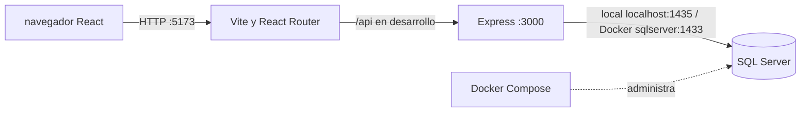

# ERP y POS para Restaurante Orígenes SV

Sistema de gestión empresarial y punto de venta desarrollado para
Restaurante Orígenes SV.

El proyecto permite administrar ventas, inventario, recetas, compras,
proveedores, cuentas por pagar, clientes, sucursales, usuarios, caja
y recursos humanos desde una misma aplicación.

## Tecnologías utilizadas

- Frontend: React, Vite y Bootstrap.
- Backend: Node.js y Express.
- Base de datos: Microsoft SQL Server.
- ORM: Sequelize.
- Autenticación: JSON Web Token (JWT).
- Validación de datos: Zod.
- Generación de documentos PDF: PDFKit.
- Pruebas: Node.js Test Runner.
- Contenedores: Docker y Docker Compose.
- Control de versiones: Git y GitHub.

## Módulos del sistema

- Punto de venta (POS).
- Gestión de productos y categorías.
- Gestión de clientes y sucursales.
- Autenticación y control de roles.
- Gestión de caja.
- Inventario de insumos.
- Recetas y consumo de ingredientes.
- Compras y proveedores.
- Cuentas por pagar.
- Recursos humanos.
- Reportes de ventas.
- Generación de comprobantes PDF.

## Arquitectura

El sistema utiliza una arquitectura cliente-servidor. En desarrollo local,
el backend conecta a `localhost:1435`; dentro de Docker conecta al servicio
`sqlserver:1433`.



- `frontend/`: React `18.3.1`, React Router, Vite, Bootstrap y Reactstrap. React 18 se usa para ajustarse a los peer dependencies de Reactstrap y `react-popper` sin omitir la validación de npm.
- `backend/`: Express con CommonJS, middleware de seguridad y conexión reutilizable a SQL Server mediante `mssql`.
- `database/`: scripts SQL de los módulos del sistema.
- `backend/scripts/setupDb.js`: crea la base configurada y ejecuta los scripts de instalación.
- `docker-compose.yml`: SQL Server 2022, instalador y aplicación con volumen persistente.

```text
Navegador
    |
    v
Frontend (React + Vite)
    |
    v
Backend (Node.js + Express)
    |
    v
SQL Server
```

El frontend realiza solicitudes HTTP a la API del backend.
El backend valida las solicitudes, aplica las reglas del negocio
y realiza las operaciones correspondientes en la base de datos.

## Estructura del proyecto

```text
ERP_y_POS_para_Restaurante_Origenes_SV/
|
|-- backend/
|   |-- scripts/
|   |   |-- runSql.js
|   |   |-- setupDb.js
|   |-- src/
|   |-- test/
|   |-- Dockerfile
|   |-- Dockerfile.setup
|   |-- package.json
|   |-- .env.example
|
|-- frontend/
|   |-- src/
|   |-- Dockerfile
|   |-- package.json
|   |-- vite.config.js
|   |-- .env.example
|
|-- database/
|   |-- pos/
|   |-- soporte/
|   |-- caja/
|   |-- rrhh/
|   |-- inventario/
|   |-- compras/
|   |-- seed.sql
|
|-- .dockerignore
|-- .env.example
|-- docker-compose.yml
|-- README.md
```

## 1. Requisitos

Para ejecutar el sistema mediante Docker:

- Git.
- Docker Desktop o Docker Engine con Docker Compose.
- Navegador web.

Para ejecutar el frontend y backend manualmente:

- Node.js 22.12.0 o superior.
- npm.
- Una instancia de SQL Server disponible.

SQL Server Management Studio (SSMS) es opcional y puede utilizarse
para consultar y administrar la base de datos.

## 2. Clonar el repositorio

```bash
git clone https://github.com/Vinicio-1297/ERP_y_POS_para_Restaurante_Origenes_SV.git
cd ERP_y_POS_para_Restaurante_Origenes_SV
```

## 3. Instalación automática mediante Docker

Esta es la forma recomendada para ejecutar el proyecto completo
en un equipo nuevo.

### Configurar las variables de entorno

Desde la raíz del repositorio, crear el archivo `.env` utilizando
el archivo `.env.example`.

En PowerShell:

```powershell
Copy-Item .env.example .env
```

En Linux o macOS:

```bash
cp .env.example .env
```

| Archivo | Variables | Uso |
| --- | --- | --- |
| `.env` | `DB_PASSWORD`, `DB_NAME`, `SQLSERVER_PORT`, `DB_SEED_DEMO`, `JWT_SECRET`, `SUPPORT_EMAIL` | Configuración de Docker Compose. |
| `backend/.env` | `PORT`, `JWT_SECRET`, `CORS_ORIGIN`, `DB_SERVER`, `DB_PORT`, `DB_NAME`, `DB_USER`, `DB_PASSWORD`, `DB_ENCRYPT`, `DB_TRUST_SERVER_CERT`, `DB_SEED_DEMO` | Configuración del backend local; usa `DB_PORT=1435`. |
| `frontend/.env` | `VITE_API_URL` | Prefijo de la API visible para Vite; localmente usa `/api`. Solo las variables `VITE_*` se exponen al navegador. |

El archivo contiene las siguientes variables:

```env
DB_PASSWORD=LocalDev_Passw0rd!
DB_NAME=restaurante
SQLSERVER_PORT=1435
DB_SEED_DEMO=true

JWT_SECRET=replace-with-a-long-random-secret-before-use
SUPPORT_EMAIL=soporte@example.com
```

Descripción de las variables:

| Variable | Descripción |
|---|---|
| DB_PASSWORD | Contraseña de SQL Server. |
| DB_NAME | Nombre de la base de datos. |
| SQLSERVER_PORT | Puerto externo de SQL Server. |
| DB_SEED_DEMO | Activa o desactiva los datos de demostración. |
| JWT_SECRET | Secreto utilizado para firmar los tokens JWT. |
| SUPPORT_EMAIL | Correo de soporte del sistema. |

Antes de iniciar el sistema, reemplazar el valor de ejemplo
de JWT_SECRET por un secreto aleatorio y seguro.

La contraseña de SQL Server incluida en el ejemplo está destinada
únicamente a entornos locales de desarrollo.

Si `SQLSERVER_PORT` está ocupado, elige otro puerto disponible.
Al ejecutar el backend fuera de Docker, configura `DB_PORT` con ese
mismo puerto; dentro de Docker se utiliza el puerto interno `1433`.

### Iniciar el sistema

Asegurarse de que Docker esté ejecutándose.

Desde la raíz del repositorio:

```bash
docker compose up -d --build
```

Este comando se encarga de:

1. Descargar la imagen de SQL Server.
2. Construir las imágenes del instalador, backend y frontend.
3. Iniciar SQL Server.
4. Esperar a que SQL Server esté disponible.
5. Crear la base de datos si no existe.
6. Ejecutar los scripts de creación de tablas.
7. Cargar los datos iniciales.
8. Cargar los datos de demostración si están habilitados.
9. Iniciar el backend.
10. Iniciar el frontend.

No es necesario instalar Node.js ni ejecutar npm manualmente
cuando se utiliza esta modalidad.

### Acceder al sistema

Una vez iniciados los servicios, abrir:

http://localhost:5173

La API del backend está disponible en:

http://localhost:3000/api

### Verificar los contenedores

```bash
docker compose ps -a
```

Los estados esperados son:

| Servicio | Estado esperado |
|---|---|
| sqlserver | Up (healthy) |
| db-setup | Exited (0) |
| backend | Up (healthy) |
| frontend | Up |

El contenedor db-setup termina automáticamente después de instalar
la base de datos. El estado Exited (0) indica que terminó correctamente.

### Consultar los registros

```bash
docker compose logs db-setup
```

```bash
docker compose logs backend
```

```bash
docker compose logs frontend
```

```bash
docker compose logs sqlserver
```

### Detener el sistema

```bash
docker compose down
```

Este comando detiene los servicios sin eliminar el volumen
que almacena la base de datos.

Para iniciar nuevamente el sistema:

```bash
docker compose up -d
```

## 4. Instalación manual de la base de datos

También es posible instalar la base de datos sin ejecutar
el frontend y backend mediante Docker.

Si se desea utilizar únicamente SQL Server y el instalador
de Docker Compose:

```bash
docker compose up -d --build db-setup
```

Si ya se dispone de una instancia de SQL Server, se puede utilizar
directamente el script de instalación del backend.

Desde la raíz del repositorio:

```bash
cd backend
```

Crear el archivo `.env`.

En PowerShell:

```powershell
Copy-Item .env.example .env
```

En Linux o macOS:

```bash
cp .env.example .env
```

Configurar las variables según la instancia de SQL Server utilizada.

```env
PORT=3000
JWT_SECRET=replace-with-a-long-random-secret-before-use
CORS_ORIGIN=http://localhost:5173

DB_SERVER=localhost
DB_PORT=1435
DB_NAME=restaurante
DB_USER=sa
DB_PASSWORD=LocalDev_Passw0rd!
DB_ENCRYPT=false
DB_TRUST_SERVER_CERT=true
DB_SEED_DEMO=true

SUPPORT_EMAIL=soporte@example.com
```

Reemplazar JWT_SECRET por un secreto seguro y ajustar las credenciales
y el puerto de SQL Server según corresponda.

Instalar las dependencias:

```bash
npm ci
```

Ejecutar el instalador:

```bash
npm run db:setup
```

El script crea la base de datos si no existe y ejecuta los módulos
en el siguiente orden:

1. POS.
2. Soporte.
3. Caja.
4. Recursos humanos.
5. Inventario.
6. Compras.

Posteriormente, carga los datos básicos y, si está habilitada
la opción DB_SEED_DEMO, los datos de demostración.

La cuenta utilizada para ejecutar el instalador debe tener permisos
suficientes para crear la base de datos y sus objetos.

## 5. Datos de demostración

La variable DB_SEED_DEMO permite controlar la carga de los datos
de demostración.

```env
DB_SEED_DEMO=true
```

Con esta opción habilitada, una instalación nueva incluye:

| Datos | Cantidad |
|---|---:|
| Sucursales | 1 |
| Usuarios | 3 |
| Categorías | 5 |
| Productos | 12 |
| Cargos | 3 |
| Empleados | 5 |
| Insumos | 41 |
| Recetas | 12 |
| Detalles de recetas | 113 |
| Existencias | 41 |
| Movimientos iniciales de inventario | 41 |
| Proveedores | 5 |
| Total | 282 |

También se cargan los correlativos y los tramos de renta
incluidos en los scripts correspondientes.

Los datos permiten probar las principales funcionalidades
sin tener que registrar manualmente todos los elementos.

### Desactivar los datos de demostración

```env
DB_SEED_DEMO=false
```

Con esta opción se instala la estructura de la base de datos
y los datos básicos necesarios, sin cargar los usuarios,
productos, empleados, proveedores, recetas ni existencias de demo.

Desactivar esta opción no elimina datos cargados anteriormente.

Una instalación sin datos de demostración requiere configurar
manualmente los usuarios, sucursales y demás datos operativos
antes de utilizar el sistema.

### Ejecutar nuevamente el instalador

```bash
npm run db:setup
```

También puede ejecutarse mediante Docker:

```bash
docker compose run --rm db-setup
```

Los scripts están diseñados para poder ejecutarse nuevamente
sin duplicar los datos iniciales en las condiciones normales
de instalación.

Las existencias que ya poseen movimientos de inventario
no se vuelven a abastecer automáticamente.

Las recetas reales no se reemplazan por recetas de demostración.
Sin embargo, los seeds pueden actualizar las recetas identificadas
como datos de demo.

Por este motivo, los datos de demostración deben utilizarse
únicamente en entornos de desarrollo y pruebas.

## 6. Usuarios de demostración

Los siguientes usuarios están disponibles cuando se habilitan
los datos de demostración:

| Rol | Correo | Contraseña |
|---|---|---|
| Administrador | admin@origenes.sv | 123456 |
| Gerente | gerente@origenes.sv | 123456 |
| Cajero | cajero@origenes.sv | 123456 |

Estas credenciales son exclusivamente para pruebas y demostraciones.
No deben utilizarse en un entorno de producción.

## 7. Ejecutar el backend sin Docker

Si el backend ya está ejecutándose mediante Docker Compose,
no es necesario realizar este procedimiento.

Desde la carpeta backend:

```bash
npm ci
```

Verificar que el archivo `.env` contiene las credenciales
correctas de SQL Server y que la base de datos está instalada.

Iniciar el servidor en modo desarrollo:

```bash
npm run dev
```

También puede iniciarse sin el modo de observación de archivos:

```bash
npm start
```

El backend estará disponible en:

http://localhost:3000

La API utiliza el prefijo:

```text
/api
```

Para comprobar que el backend está funcionando:

```text
GET /api/health
```

Dirección:

http://localhost:3000/api/health

## 8. Ejecutar el frontend sin Docker

Si el frontend ya está ejecutándose mediante Docker Compose,
no es necesario realizar este procedimiento.

Desde la carpeta frontend:

```bash
npm ci
```

Crear el archivo `.env` utilizando `.env.example`.

En PowerShell:

```powershell
Copy-Item .env.example .env
```

En Linux o macOS:

```bash
cp .env.example .env
```

Configurar la dirección de la API:

```env
VITE_API_URL=/api
```

Iniciar el frontend:

```bash
npm run dev
```

Abrir:

http://localhost:5173

El servidor de Vite redirige las solicitudes realizadas a `/api`
hacia el backend.

No hay un API Gateway independiente. En desarrollo local, el navegador
solicita rutas relativas como `/api/health`; Vite reenvía `/api/*` a
`http://localhost:3000`, y el backend se conecta a SQL Server en
`localhost:1435`. Con Docker, el proxy usa el servicio interno del backend,
y este se conecta a `sqlserver:1433`. Docker publica el puerto externo
configurado por `SQLSERVER_PORT` (por defecto `1435`) hacia el puerto interno
`1433`. En producción, el proxy de desarrollo de Vite no está disponible y
debe configurarse el enrutamiento del servidor que aloje frontend y API.

Cuando se ejecuta localmente, utiliza:

```text
http://localhost:3000
```

Para generar la compilación del frontend:

```bash
npm run build
```

## 9. Inventario y recetas

El sistema permite administrar los insumos utilizados
para elaborar los productos del restaurante.

Cada insumo posee:

- Nombre.
- Categoría.
- Unidad de medida.
- Estado.
- Existencias por sucursal.
- Stock mínimo.
- Historial de movimientos.

Las unidades de medida disponibles incluyen:

- Gramos (g).
- Kilogramos (kg).
- Mililitros (ml).
- Litros (l).
- Unidades.

Los productos elaborados pueden tener una receta asociada.

Cada receta contiene los ingredientes necesarios,
sus cantidades y el rendimiento de la preparación.

### Descuento de inventario por venta

Al registrar una venta de un producto elaborado, el sistema
calcula la cantidad de ingredientes que debe descontar.

```text
Consumo = (cantidad del ingrediente / rendimiento)
          * cantidad de productos vendidos
```

Por ejemplo, una receta de croissants utiliza 500 gramos
de harina para producir 10 unidades.

Si se venden 3 croissants:

```text
Consumo = (500 / 10) * 3
Consumo = 150 gramos de harina
```

El sistema descuenta los ingredientes de las existencias
correspondientes a la sucursal de la venta.

Cuando varios productos utilizan el mismo ingrediente,
las cantidades necesarias se acumulan antes de realizar
el descuento.

Si no existe suficiente inventario, la operación se rechaza
para evitar existencias negativas.

El descuento de ingredientes y el registro del pedido
se realizan dentro de una transacción.

### Anulación de ventas

Cuando se anula una venta que generó movimientos de inventario,
el sistema devuelve las cantidades descontadas originalmente.

Los movimientos de devolución quedan registrados en el historial
del inventario.

Las recetas de demostración contienen cantidades aproximadas
para facilitar las pruebas del sistema y no representan
recetas comerciales oficiales del restaurante.

## 10. Compras y cuentas por pagar

El módulo de compras permite gestionar:

- Proveedores.
- Registro de compras.
- Detalles de compras.
- Entradas de inventario.
- Condiciones de pago.
- Compras al contado y al crédito.

Las compras al crédito permiten generar cuentas por pagar
asociadas a los proveedores.

El módulo de cuentas por pagar permite gestionar los saldos,
registrar pagos y consultar el estado de las obligaciones.

Las operaciones relacionadas con las compras y los movimientos
de inventario utilizan transacciones para mantener
la consistencia de los datos.

## 11. Autenticación y seguridad

El sistema utiliza JWT para autenticar las solicitudes
realizadas a las rutas protegidas.

Las contraseñas de los usuarios se almacenan utilizando bcrypt.

Los roles disponibles para el acceso al sistema son:

- Administrador.
- Gerente.
- Cajero.

Cada rol posee permisos según las funcionalidades
que le corresponden.

Las solicitudes del backend se validan mediante Zod.

También se utilizan:

- Helmet para encabezados de seguridad HTTP.
- CORS para controlar los orígenes permitidos.
- Limitación de solicitudes.
- Consultas parametrizadas.
- Manejo centralizado de errores.
- Transacciones para operaciones relacionadas.

### Inicio de sesión mediante la API

```text
POST /api/auth/login
```

Ejemplo de solicitud:

```json
{
  "rol": "administrador",
  "correo": "admin@origenes.sv",
  "password": "123456"
}
```

Si las credenciales son correctas, el backend devuelve
un token JWT y los datos del usuario.

Para acceder a las rutas protegidas, incluir el token
en el encabezado Authorization.

```text
Authorization: Bearer TOKEN
```

## 12. Pruebas del backend

El backend utiliza el sistema de pruebas integrado de Node.js.

Desde la carpeta backend:

```bash
npm ci
npm test
```

También pueden ejecutarse las pruebas dentro del contenedor
del backend:

```bash
docker compose exec backend npm test
```

Las pruebas cubren funcionalidades relacionadas con:

- Validación de solicitudes.
- Autenticación.
- Usuarios y roles.
- Productos y pedidos.
- Inventario.
- Movimientos de inventario.
- Recetas.
- Descuento de ingredientes por venta.
- Devolución de ingredientes por anulación.
- Compras.
- Proveedores.
- Cuentas por pagar.
- Pagos.
- Manejo de errores.

Durante el desarrollo del módulo de calidad y entrega,
se ejecutaron 386 pruebas automatizadas satisfactoriamente.

Además, se realizaron pruebas manuales de integración
con SQL Server para comprobar:

- Creación automática de la base de datos.
- Carga de los datos de demostración.
- Ejecución repetida del instalador.
- Instalación sin datos de demostración.
- Descuento de ingredientes al registrar una venta.
- Devolución de ingredientes al anular una venta.
- Rechazo de ventas con inventario insuficiente.
- Conservación de existencias al ejecutar nuevamente los seeds.
- Inicio de los servicios mediante Docker Compose.

## 13. Scripts disponibles del backend

| Comando | Descripción |
|---|---|
| npm start | Inicia el backend. |
| npm run dev | Inicia el backend en modo desarrollo. |
| npm test | Ejecuta las pruebas automatizadas. |
| npm run db:setup | Instala todos los módulos de la base de datos. |
| npm run db:pos | Ejecuta los scripts del POS. |
| npm run db:soporte | Ejecuta los scripts de soporte. |
| npm run db:caja | Ejecuta los scripts de caja. |
| npm run db:rrhh | Ejecuta los scripts de recursos humanos. |
| npm run db:inventario | Ejecuta los scripts de inventario. |
| npm run db:compras | Ejecuta los scripts de compras. |
| npm run db:migrate | Ejecuta las migraciones de soporte. |
| npm run db:seed | Ejecuta los seeds de soporte. |

Para una instalación nueva se recomienda utilizar db:setup
en lugar de ejecutar los módulos individualmente.

## 14. Conexión mediante SQL Server Management Studio

Si SQL Server se ejecuta mediante Docker Compose,
puede accederse desde SSMS utilizando los siguientes datos:

| Campo | Valor |
|---|---|
| Servidor | localhost,1435 |
| Autenticación | SQL Server Authentication |
| Usuario | sa |
| Contraseña | Valor de DB_PASSWORD |
| Base de datos | restaurante |

El puerto y el nombre de la base de datos pueden variar
según la configuración del archivo `.env`.

En entornos locales puede ser necesario habilitar
la opción Trust Server Certificate.

## 15. Persistencia de datos

Docker Compose utiliza un volumen para almacenar
los archivos de SQL Server.

Esto permite conservar la información aunque los contenedores
se detengan o se vuelvan a crear.

Para detener los servicios conservando los datos:

```bash
docker compose down
```

Para eliminar los contenedores y sus volúmenes:

```bash
docker compose down -v
```

ADVERTENCIA: el segundo comando elimina el volumen de SQL Server
y puede provocar la pérdida de todas las bases de datos
almacenadas en dicho volumen.

Utilizarlo únicamente cuando se desee reiniciar completamente
un entorno de desarrollo y no sea necesario conservar sus datos.

## 16. Consideraciones de seguridad y despliegue

La configuración actual está orientada al desarrollo,
las pruebas y la demostración académica del sistema.

Antes de utilizar el sistema en producción, se recomienda:

- Desactivar los datos de demostración.
- Eliminar o reemplazar las cuentas de prueba.
- Utilizar contraseñas seguras.
- Configurar un secreto JWT seguro.
- Utilizar una cuenta de base de datos con privilegios limitados.
- Configurar HTTPS.
- Restringir el acceso externo a SQL Server.
- Configurar respaldos periódicos.
- Utilizar una compilación de producción del frontend.
- Revisar las configuraciones fiscales y operativas del sistema.

Los archivos `.env` contienen información sensible
y no deben subirse al repositorio.

Los archivos `.env.example` sirven como referencia
para configurar nuevas instalaciones.

## 17. Proyecto académico

ERP y POS para Restaurante Orígenes SV.

Proyecto desarrollado como parte de la asignatura
de Programación Web de la Universidad Centroamericana
José Simeón Cañas (UCA), El Salvador.