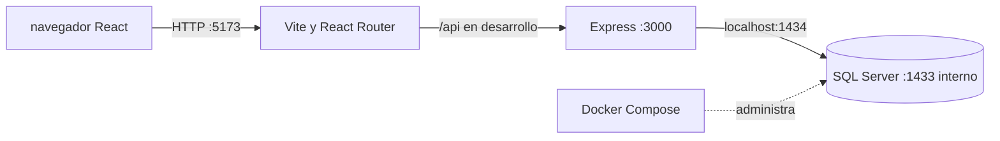

# Orígenes SV POS/ERP

Monorepositorio con la configuración inicial para un sistema de restaurante. Incluye la base técnica, no la lógica funcional de ventas, inventario, compras, caja o planilla.

## Arquitectura



- `frontend/`: React `18.3.1`, React Router, Vite, Bootstrap y Reactstrap. React 18 se usa para ajustarse a los peer dependencies de Reactstrap y `react-popper` sin omitir la validación de npm.
- `backend/`: Express con CommonJS, middleware de seguridad y conexión reutilizable a SQL Server mediante `mssql`.
- `database/`: scripts SQL. `seed.sql` es solo un marcador; el equipo agregará el esquema y los datos de inicio.
- `docker-compose.yml`: SQL Server 2022 con volumen persistente.

### Estructura

```text
frontend/
	src/components/      Componentes compartidos
	src/hooks/           Hooks de React
	src/pages/           Vistas de la aplicación
	src/routes/          Rutas del frontend
	src/services/        Peticiones HTTP con fetch
backend/src/
	config/              Pool y configuración de base de datos
	controllers/         Adaptadores HTTP
	middlewares/         Seguridad, validación y errores
	routes/              Rutas de la API
	services/            Acceso a datos y servicios
database/              Scripts SQL
```

## Requisitos

- Node.js `22.12` o posterior y npm; se recomienda Node.js 24 LTS.
- Docker Desktop actualizado con Docker Compose.
- Puertos locales disponibles: `5173` (frontend), `3000` (API) y `1434` (SQL Server en el host; dentro del contenedor permanece en `1433`).

## Configuración

Clona el repositorio y crea los archivos locales de entorno una sola vez:

```powershell
git clone <URL_DEL_REPOSITORIO>
Set-Location <CARPETA_DEL_REPOSITORIO>
Copy-Item .env.example .env
Copy-Item backend/.env.example backend/.env
Copy-Item frontend/.env.example frontend/.env
```

| Archivo | Variables | Uso |
| --- | --- | --- |
| `.env` | `DB_PASSWORD` | Contraseña `sa` que Docker Compose asigna a SQL Server. |
| `backend/.env` | `PORT`, `JWT_SECRET`, `CORS_ORIGIN`, `DB_SERVER`, `DB_PORT`, `DB_NAME`, `DB_USER`, `DB_PASSWORD`, `DB_ENCRYPT`, `DB_TRUST_SERVER_CERT` | Configuración de la API y SQL Server; localmente usa `DB_PORT=1434`. |
| `frontend/.env` | `VITE_API_URL` | Prefijo de la API visible para Vite; localmente usa `/api`. Solo las variables `VITE_*` se exponen al navegador. |

Usa una contraseña fuerte para `DB_PASSWORD` en el `.env` raíz y copia el mismo valor en `backend/.env`. Cambia `DB_NAME` de `master` cuando el equipo cree la base de datos de la aplicación. Genera un secreto local para JWT en PowerShell con `node -e "console.log(require('crypto').randomBytes(32).toString('hex'))"` y pega el resultado en `JWT_SECRET`.

Los `.env` reales están ignorados por Git. Los `.env.example` son plantillas que sí deben versionarse. No compartas ni confirmes secretos. Los valores de ejemplo son solo para desarrollo local.

## Instalar y ejecutar

Desde la raíz, instala las dependencias fijadas por cada lockfile y levanta SQL Server:

```powershell
Set-Location backend
npm ci
Set-Location ../frontend
npm ci
Set-Location ..
docker compose up -d
```

Inicia cada servidor en una terminal independiente:

```powershell
# Terminal 1: API
Set-Location backend
npm run dev
```

```powershell
# Terminal 2: frontend
Set-Location frontend
npm run dev
```

Abre <http://localhost:5173>. Para producción, el backend se inicia con `npm start` desde `backend/`; el frontend se prepara con `npm run build` desde `frontend/`. El proxy definido en Vite es solo para desarrollo: producción debe configurar un proxy inverso para `/api` o una URL de API y CORS adecuados.

Para detener SQL Server: `docker compose down`. El volumen conserva los datos. `docker compose down -v` también elimina el volumen y los datos, por lo que debe usarse con cuidado.

## Gateway y flujo HTTP

No hay un API Gateway independiente. En desarrollo, el navegador solicita rutas relativas como `/api/health`; Vite reenvía `/api/*` a `http://localhost:3000`. Express monta las rutas bajo `/api`, y el backend se comunica con SQL Server a través del pool de `backend/src/config/db.js`, conectándose a `localhost:1434`. Docker publica el puerto del host `1434` hacia el `1433` interno del contenedor. En producción, el proxy de desarrollo de Vite no está disponible y debe configurarse el enrutamiento del servidor que aloje frontend y API.

## API inicial

| Método | Ruta | Comportamiento |
| --- | --- | --- |
| `GET` | `/api/health` | Ejecuta `SELECT 1` para comprobar la conexión a SQL Server. |

Respuesta correcta (`200`):

```json
{
	"status": "ok",
	"message": "API y base de datos conectadas"
}
```

Si la base no está disponible, el middleware central devuelve `500` con un mensaje genérico. El endpoint de salud requiere que el backend y SQL Server estén levantados. No hay todavía endpoints de login ni de los módulos del restaurante.

## Seguridad implementada

- `helmet` establece cabeceras HTTP de seguridad.
- `cors` permite el origen configurado en `CORS_ORIGIN`.
- `express-rate-limit` limita las solicitudes a 100 por ventana de 15 minutos.
- `express.json` limita el cuerpo JSON a 1 MB.
- Middleware Zod disponible para validar entradas; aún debe conectarse a cada endpoint nuevo.
- Middleware JWT disponible para verificar tokens; falta implementar login, emisión de tokens y permisos.
- `bcryptjs` ofrece hashing bcrypt con 12 rondas en el servicio de contraseñas; no se guardan contraseñas todavía porque no hay usuarios implementados.
- Las consultas nuevas deben parametrizar todos los valores dinámicos con `request.input(...)`; nunca concatenar entradas en SQL. `SELECT 1` es constante y no recibe datos externos.
- SQL Server usa un volumen persistente local. Las contraseñas y el secreto JWT deben mantenerse fuera de Git.

Para producción, configura TLS y certificados válidos (`DB_ENCRYPT=true`, `DB_TRUST_SERVER_CERT=false` cuando corresponda), credenciales de base de datos con privilegios mínimos, secretos desde un gestor seguro y un origen CORS explícito. No uses `sa` como usuario de aplicación en producción.

## Auditoría de dependencias

Ejecuta `npm audit` por separado en `frontend/` y `backend/`. Revisa cada aviso y su ruta de dependencia; actualiza las versiones fijadas, vuelve a instalar y prueba la aplicación. `npm audit fix` puede aplicar correcciones compatibles. Evita `npm audit fix --force`, porque puede introducir cambios incompatibles. Investiga y documenta avisos que no tengan corrección disponible antes de desplegar.

## Pendiente antes de producción

- Definir `schema.sql`, estrategia de migraciones, datos iniciales y política de respaldo/restauración.
- Implementar autenticación, emisión de JWT, roles y permisos; aplicar Zod a las entradas de cada ruta.
- Diseñar y documentar contratos/endpoints para ventas, recetas e inventario, compras, caja y planilla.
- Añadir pruebas automatizadas para API, base de datos y flujos críticos; definir lint y formato.
- Configurar proxy inverso, HTTPS, secretos de producción, logging, monitoreo y despliegue.
- Revisar los requisitos fiscales y operativos aplicables al restaurante antes de implementar ventas y planilla.